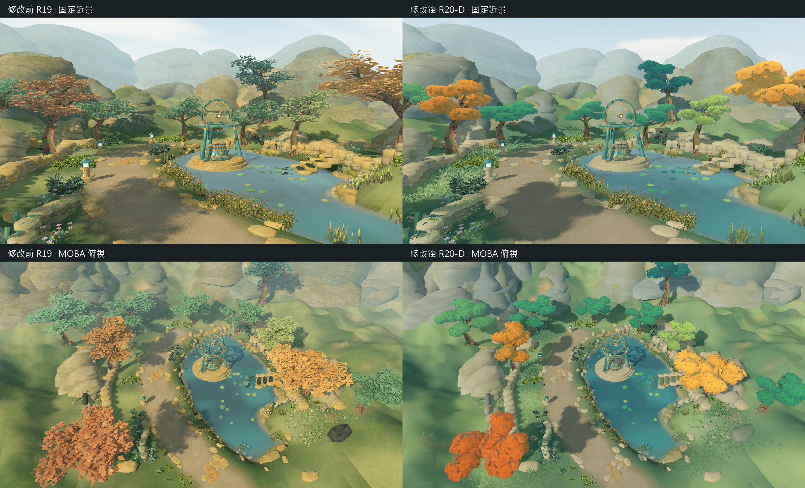
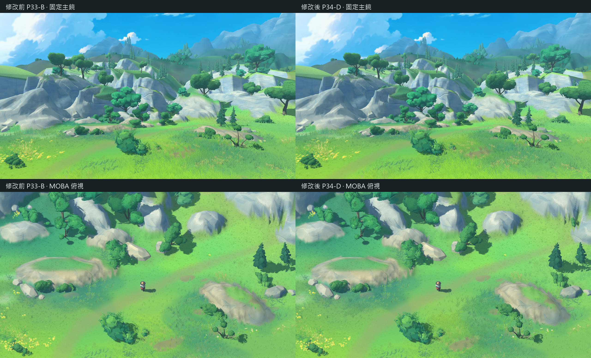

# Grove R20-D / Daylight P34-D

本次依使用者指示保存兩張場景的美術進度與實機截圖。**尚未通過90%視覺發布門檻**；整景無足夠可比原作證據可可靠量化，歷史局部分數不能代替。

| 場景 | 開啟 | 本輪改善 | 仍有差距 |
|---|---|---|---|
| 硃萼雨庭 R20-D | 根目錄 project.godot，F5後按4，C切鏡 | 葉冠體積、草群接地、石材去噪、池水 | 圓鼓山形、過長花帶、部分重複草帶 |
| 日照草坡 P34-D | studies/daylight/project.godot，M切MOBA | 右中草群高低、較寬深葉與露土，收斂螢光草尖 | 大亮綠地面、遠丘圓樹、部分岩面折紋 |

兩者為獨立Godot專案：四景圖庫使用Forward+，Daylight保持已校準的Compatibility；沒有硬改渲染器讓舊畫面失真。

## 硃萼雨庭：同設定雙鏡位

## 日照草坡：同設定雙鏡位

## 驗證

四景圖庫原通路：basin 5/5 30.40m、tide 4/4 24.72m、sunvine 6/6 32.13m、grove 5/5 29.74m，全通過。
Daylight：143.32m膠囊走測通過，公開版九張原生截圖與P34-D逐像素一致；保留同機位7/J/6及四補角。
Gallery原生Vulkan Forward+／Daylight原生OpenGL Compatibility，RTX4080 Laptop。這不是手機效能驗收。
正式release檢查仍阻擋：來源與先前評分候選不同。未竄改歷史評分以假通過，本次為使用者另外授權的checkpoint提交。
Daylight編輯器匯入仍有未定位的Safe save failed訊息，exit0；實際遊戲、原生截圖與走測正常，完整訊息保留在public_check。

## 來源與接續

兩套主Prompt、逐輪修改、失敗與得失記錄分開保存。公開版沒有原作參考圖片、遊戲解包素材或歷史ZIP。
Daylight生成素材來源見 studies/daylight/ASSET_PROVENANCE.md。
E槽原工作目錄和未提交全域設定未被本輪覆蓋；本次在隔離checkout完成合併與驗證。
